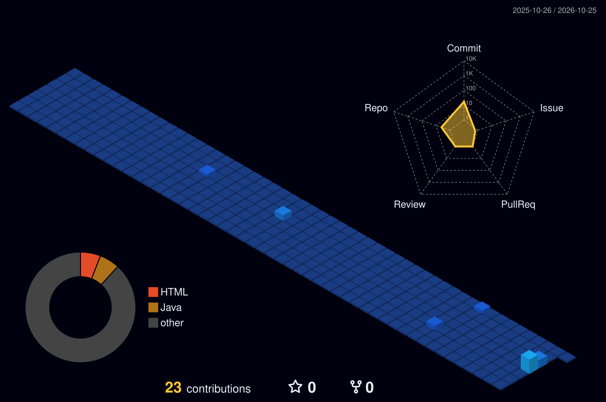

  

  

  

### 💻 Comprehensive Tech Stack

  <!-- Languages -->
  
  
  
  
  
  
  
  
   
  
  <!-- Backend & Frameworks -->
  
  
  
  
  
  
  
  
   

  <!-- Cloud & DevOps -->
  
  
  
  
  
  
  
  
   

  <!-- Databases -->
  
  
  
  
  
  

 

  

### 🌃 Contributions

  

  

 

<!-- Extra Widgets -->

  
    
  

